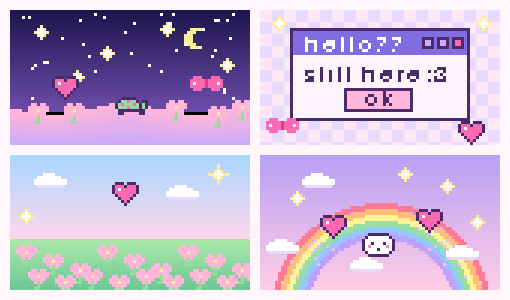
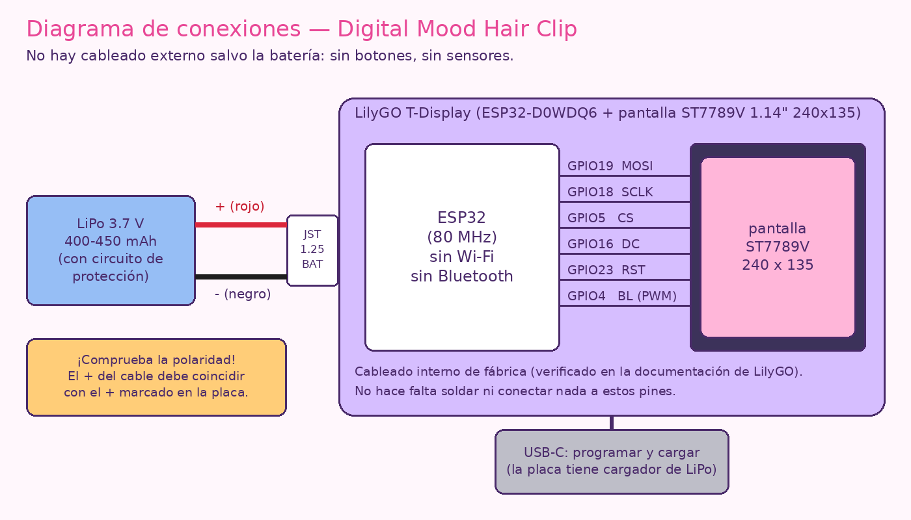
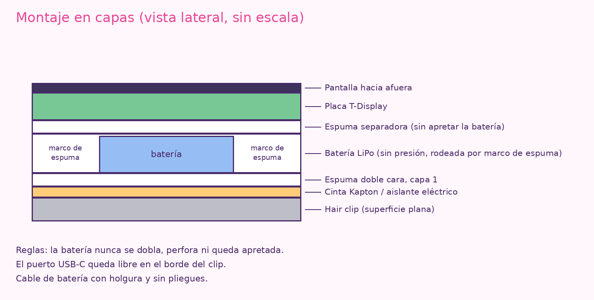

# Digital Mood Hair Clip ♡

> Un pequeño hair clip con pantalla que muestra mensajes, imágenes pixel art y estados de ánimo en un bucle
> automático. Hecho con una **LilyGO T-Display (ESP32)**, una LiPo y mucha curiosidad.
> Estética coquette · Y2K · cyber-fairy · kawaii · pixel art.



*Ilustraciones pixel art de ejemplo incluidas (originales). Reemplázalas por las tuyas.*

## ¿Qué hace?

Al encenderse, **sin botones, sin Wi-Fi, sin Bluetooth y sin Internet**:

1. **Splash `frandorturtles.exe`** durante **exactamente 2 segundos**: ventanita Y2K rosa y lavanda con
   `♡ hello, little world ♡`, `୨୧`, `frandorturtles.exe`, `loading a little bit of magic...`, barra de carga y
   una tortuguita caminando.
2. **Presentación:** `Hi! I'm Francesca ♡` → `Welcome to my little world!`
3. **My moods:** 24 frases de personalidad (`Social battery: 12%` con barrita animada, `Too many thoughts, too little RAM.`, …).
4. **Galería:** una imagen cada 3 mensajes, sin depender de URLs externas.
5. Vuelve al paso 2 y se repite **para siempre** (el splash solo sale al encender).

Animaciones: efecto de máquina de escribir con cursor, estrellitas parpadeantes, corazones flotantes,
fondos que se mueven (lunares, noche estrellada, rejilla Y2K, cielo pastel), "pegatinas" que rebotan
(moñito, flor, carita, tortuga, corazón) y una **cortina rosa/lavanda** entre pantallas.

> Nota: la fuente integrada no tiene `♡` ni `୨୧`; el firmware los **dibuja como pixel art**. En los textos usa `^` para un corazón.

## Lista de componentes

| # | Componente | Notas |
|---|---|---|
| 1 | LilyGO **T-Display** (ESP32, ST7789V 1.14" 240x135) | placa + pantalla integrada |
| 2 | Batería LiPo 3.7 V, 400–450 mAh | **con circuito de protección**, conector JST 1.25 mm, **verifica la polaridad** |
| 3 | Cinta de espuma doble cara | fijación |
| 4 | Hair clip convencional | superficie plana y firme |
| – | *(Recomendado)* Kapton / cinta aislante y un trozo de cartulina rígida | aislamiento y protección de la batería |

No hay sensores, botones ni módulos adicionales.

## Conexiones



La pantalla ya está cableada de fábrica al ESP32 (pines verificados en la documentación de LilyGO):
`MOSI=19 · SCLK=18 · CS=5 · DC=16 · RST=23 · BL=4`. Lo único que conectas es la **batería** al conector JST.
Detalles, compatibilidad eléctrica y comprobaciones: [`docs/hardware.md`](docs/hardware.md).

## Instalación y compilación

Requisitos: [VS Code + extensión PlatformIO](https://platformio.org/install/ide?install=vscode) (o PlatformIO Core) y un cable USB-C **de datos**.

```bash
git clone https://github.com/<tu-usuario>/digital-mood-hair-clip.git
cd digital-mood-hair-clip

pio run                 # compila (descarga plataforma y TFT_eSPI la primera vez)
pio run -t upload       # sube a la placa por USB-C
pio device monitor      # opcional
```

Si la subida falla, mantén pulsado el botón **BOOT/GPIO0** de la placa mientras empieza la carga e inténtalo otra vez.

## Personalizar (todo en `include/config.h`)

| Qué | Dónde |
|---|---|
| Duración de cada pantalla (3–5 s), del splash, de la cortina | `SPLASH_MS`, `INTRO_MS`, `MESSAGE_MS`, `IMAGE_MS`, `TRANSITION_MS` |
| Frases | array `MESSAGES[]` (añade/quita líneas) |
| Presentación | array `INTRO[]` |
| Barrita de batería en una frase | campo `gauge` (0–100, `-1` = sin barra) |
| Cada cuántos mensajes sale una imagen | `IMAGE_EVERY` (`0` = sin imágenes) |
| Brillo, fps, giro de pantalla | `BACKLIGHT_LEVEL`, `FRAME_MS`, `SCREEN_ROTATION` |

Ejemplo de frase nueva:

```cpp
{"hello.exe", "Soft heart, loud thoughts.", -1},
```

## Agregar tus imágenes (Pinterest, etc.)

```bash
python -m pip install -r tools/requirements.txt
# copia tus imágenes a assets/images/ y luego:
python tools/image_converter.py
pio run -t upload
```

Recorta, redimensiona a 240 x 135 y convierte a RGB565 automáticamente; puede incluso descargar por URL directa
(`python tools/image_converter.py download <url>`). Guía completa, opciones pixel art y nota sobre derechos de autor:
[`docs/image_conversion.md`](docs/image_conversion.md).

## Montaje físico



Guía paso a paso (peso, protección de la batería, aislamiento, acceso al puerto de carga):
[`docs/assembly.md`](docs/assembly.md).

## Estructura del repositorio

```
digital-mood-hair-clip/
├── README.md
├── LICENSE                      (MIT)
├── .gitignore
├── platformio.ini               (placa, librerías, pines de pantalla)
├── src/main.cpp                 (firmware: escenas, animaciones, transiciones)
├── include/config.h             (mensajes, tiempos, opciones)
├── assets/
│   ├── images/                  (tus imágenes + converted/*.h y gallery.h)
│   └── pixel_art/               (fuentes pixel art 80x45 de ejemplo)
├── tools/
│   ├── image_converter.py       (imagen → RGB565 + gallery.h)
│   ├── make_example_art.py      (regenera el arte de ejemplo)
│   ├── make_diagrams.py         (regenera docs/img/*)
│   └── requirements.txt
└── docs/
    ├── hardware.md · assembly.md · image_conversion.md
    └── img/                     (diagramas)
```

## Estado de verificación (honestidad ante todo)

Esto **sí** se comprobó al generar el proyecto:

- ✅ Pines de pantalla, controlador y características de la placa contrastados con la documentación oficial de LilyGO.
- ✅ `tools/image_converter.py` ejecutado de verdad: convierte, quita, lista, regenera `gallery.h`, con galería vacía y con imágenes.
- ✅ `src/main.cpp` pasa una revisión de sintaxis en C++11 (`g++ -fsyntax-only -Wall -Wextra`) con cabeceras simuladas de Arduino/TFT_eSPI, con galería vacía y llena.
- ✅ Estructura de archivos y rutas revisadas.

Esto **no** se pudo comprobar (no hay hardware ni acceso a las librerías reales en el entorno de generación):

- ❌ **El firmware no se compiló con PlatformIO ni se probó en una T-Display física.** Puede haber detalles que ajustar
  (por ejemplo orientación, tono de colores en imágenes, brillo, fluidez).
- ❌ Consumo y autonomía reales: no medidos.
- ❌ Montaje físico: la guía es de buenas prácticas, no probada.

### Solución de problemas

| Síntoma | Qué probar |
|---|---|
| Pantalla en blanco | revisa `platformio.ini` (pines), sube `BACKLIGHT_LEVEL`, comprueba que la placa es la T-Display original |
| Imagen al revés | `SCREEN_ROTATION` = `3` |
| Colores raros **solo en las imágenes** | `IMAGE_SWAP_BYTES` = `false` |
| Colores invertidos en todo | abre un *issue* con una foto; puede ser otra revisión de pantalla |
| "Sin memoria :(" | quita imágenes de la galería (`image_converter.py remove`) |
| No sube | cable USB de datos; mantén BOOT/GPIO0 al subir |

## Créditos y licencia

Proyecto de Francesca (**frandorturtles**). Código y arte de ejemplo bajo licencia **MIT** (ver [`LICENSE`](LICENSE)).
Usa [TFT_eSPI](https://github.com/Bodmer/TFT_eSPI) de Bodmer (licencia propia, ver su repositorio).
Placa: LilyGO T-Display. Las imágenes que añadas de otras personas conservan sus propios derechos.
